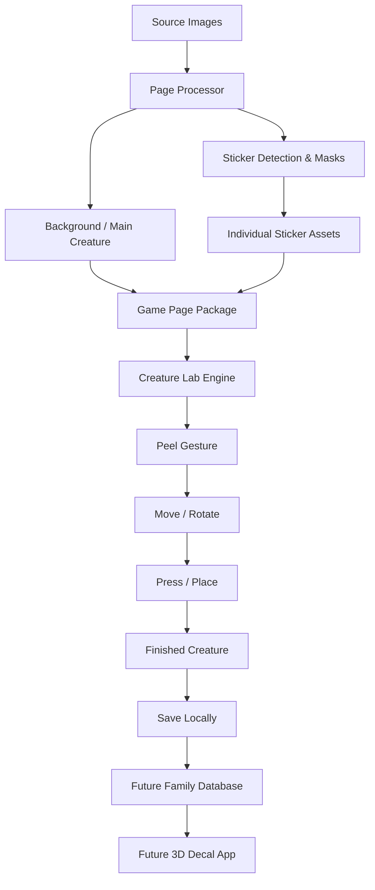

# Felix Stickers — schematic

**Track: A. Family play** (proposed, to confirm in `convo/convo v0.1.md` Q2)
**Status: idea** (round 1 questions open in `convo/convo v0.1.md`; no build yet). Written 2026-11-23 from Jimmy's concept ("Creature Lab – Sticker Playground") and three reference images.

## Purpose

A warm, tactile sticker playground for young children on an iPad. One central creature, a sticker tray, and free placement: peel a sticker from the sheet, drag it, twist it, press it down. It should feel like playing with real stickers, not like dragging pictures around.

The first build tests one question only: **does peel → move → rotate → press feel magical, or like dragging images?**

## Scope of the first build (proposed)

In:
- One full-screen page with one creature (drawn in SVG; see `convo v0.1.md` Q3).
- About 20 stickers in one tray, scrollable.
- Peel, drag, two-finger rotate, press to stick. Overlap allowed.
- Undo (kid-friendly, no penalty) and Reset (in ⚙️).
- A simple Save: the composition is kept on the device and listed in My Creations (Q6).
- ⚙️ gear (lower right) with options, the Notes for improvement box, and the error panel (opt-in).
- Locked gestures (see below).

Out (parked on purpose):
- AI sticker generation, accounts, sound, the family database, 3-D decals, sticker-sheet detection from photos.

## Functional flow

For the first build, the page processor is replaced by hand-made assets (a JSON list of stickers with image path, mask path and size). Detection comes later.

## Screen layout

| Area | Contents |
|---|---|
| Top | Title "Felix Stickers – [sheet name, 3+ words]" (convo Q1, Q4, Q11), then the ⚙️ settings button, then the Undo button next to it. Undo is on by default; a toggle in ⚙️ hides it. |
| Play area | Background + creature. Free placement, overlap allowed. Takes most of the screen. |
| Tray | One sheet of stickers, no tabs (convo Q4). Scroll, peel, drag from the sheet. An empty space stays where a sticker was taken. |
| Save | "Save My Creature" (large purple button) and My Creations, on the bottom bar (convo Q6a). |
| ⚙️ | Lower right, fades after a while, shows on a circle stroke (convo Q8). Undo toggle, Reset (with "Are you sure?"), Notes for improvement, errors (opt-in), the home-screen note, database check later. |

Track A rules: few words, icons with short labels, large touch targets (48–68px), warm pastel palette (vanilla, sage, peach, mint, coral), 2.5–3.5px dark lines, offset shadows.

## Interaction rules

| Action | Result |
|---|---|
| Pull a sticker corner | Sticker lifts from the sheet with a small curl |
| Keep pulling | Sticker detaches and follows the finger |
| Drag | Moves across the scene |
| Two fingers twist | Rotates |
| Release on canvas | **Sticker floats** (stays movable, can be picked up again) |
| Press (tap) on a floating sticker | **Commits**: it sticks for this session |
| Overlap another sticker | Allowed |
| Sticker used up | Empty space remains on the sheet |
| Undo | Removes the last action (peel, move, rotate, press) |

**Change from the concept (Jimmy's own edit, kept):** placement is not irreversible on release. Release floats the sticker; a press commits it. This is what real sticker play feels like.

## Gesture lock (iPad)

The tactile play must not be taken over by the browser. The page:
- sets `touch-action: none` on the play area and tray, and `overscroll-behavior: none` on the page;
- uses a viewport with `user-scalable=no` and `maximum-scale=1`;
- blocks `gesturestart`, `gesturechange`, `gestureend` (iOS pinch zoom), double-tap zoom, long-press callouts, text selection, the context menu and pull-to-refresh;
- runs as a Home Screen app (`apple-mobile-web-app-capable`), which removes most of Safari's chrome.

**Limit to show, not hide:** iOS Safari's left-edge swipe to go back cannot be turned off by a web page. In a Home Screen app it is much less likely to fire, and the page keeps its touches on the canvas near the edges. The page will say so in ⚙️ ("Add to Home Screen for the full experience").

## Data architecture

Three systems, kept apart:

**A. Content** — background, creature, sticker images, masks, sizes, metadata. Files in `assets/`, one JSON manifest (`stickers.json`). Read-only.

**B. Game state** — available stickers (per sheet), placed stickers (id, x, y, rotation, scale, z-order), undo history (last 50 actions), saved composition. Held in memory; saved creations in device storage (localStorage, in a try/catch; the page works if storage is blocked).

**C. Family library (later)** — read/write for saving creations; read-only for other apps to fetch sticker assets and compositions. Not in the first build. The save and load functions go through one small interface (`library.save(composition)`, `library.list()`, `library.load(id)`) so the database can be plugged in later.

## Feedback notes

Per the nursery convention, the first build includes:
- a notes box in ⚙️ labelled "Notes for improvement", saving each note with the item it is about (which sticker or screen), the version and the time;
- a way to read the notes back in ⚙️;
- notes stored on the device only (no database in this round). Built from `02 Refs/Skills/feedback_notes.md`.

## Database

Not in the first build. When notes or creations must persist across devices, plan it with `02 Refs/Skills/supabase_link.md` (Family project, prefix `fs_`, RLS on, publishable key only, SQL written first and applied only when Jimmy asks).

## Files (planned)

`index.html`, `css/`, `js/` (engine, gestures, tray, save, gear, notes), `assets/` (creature, stickers, background), `stickers.json`, `schematic.md`, `CLAUDE.md`, `convo/`. Shared AI notes in `04 AI/Felix Stickers/`.

## Open questions

See `convo/convo v0.1.md`. Nothing is built until those are answered.

## Changes

- 2026-11-23: schematic written from the concept. Status idea.
- 2026-11-23: round 1 answers recorded in `convo v0.1.md`. Single sheet, title with sheet name, settings and undo at the top. Q11 answered: each sheet has its own name (3+ words) in its data file; test sheets also carry a Test# id. Q10 answered: the uploaded sheets are for testing only, never published. Later: a core prompt for ChatGPT that turns an idea into a sticker sheet; its test outputs are named Test# (not built yet). No build yet.
